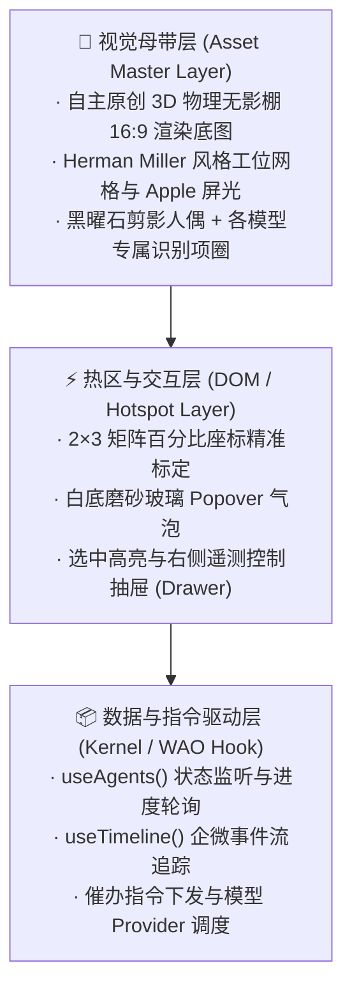

# WeCom Agent Office · 白棚工位设计与实现方案 (White Studio Design Spec)

> **设计哲学**：真实 · 简单 · 高级 (Realistic, Clean & Simple, Premium)  
> **视觉基调**：拒绝暗黑模式，采用 Apple / Dieter Rams 纯白工业极简美学；使用 100% 自主原创 3D 白棚渲染母带，杜绝任何第三方资产版权风险。  
> **工程落地**：重构 `ui-office-studio` 插件，打通「3D 母带视窗 + 精确微交互热区 + 侧边遥测抽屉 + 在册智能体 Bento 网格」。

---

## 1. 核心设计原则与架构分层

### 1.1 三层解耦架构



### 1.2 为什么能做到“真实、简单、高级”？

| 维度 | 传统 Demo 做法 (已废弃) | 本方案 (已重构落地) |
|---|---|---|
| **色彩与光影** | 刺眼黑底赛博朋克 / 玩具感亮绿发光 | **纯白无影穹顶柔光** (`#FFFFFF` + `#F8FAFC`)，搭配物理环境光遮蔽 (AO) 柔和漫反射 |
| **视觉资产** | 引用 Marvis 等第三方视频，有版权隐患与白屏风险 | **100% 自研 3D 渲染母带**（16:9 物理建模），Pi 趴桌小憩、DeepSeek/Claude 敲击屏幕 |
| **交互浮层** | 粗糙纯黑底框 (`#0A0A0A`)，遮挡视线 | **白底多层级高质感磨砂** (`rgba(255,255,255,0.96); backdrop-filter: blur(20px)`) |
| **信息架构** | 只有单一画布或单一表格 | **上下联动**：上方 3D 物理工位全景，下方 Bento 员工卡片册，右侧滑出深度操作抽屉 |

---

## 2. 视觉资产与席位坐标标定

### 2.1 3D 渲染母带规格
- **文件路径**：`plugins/ui-office-studio/ui/assets/office-studio-bespoke.jpg`
- **显示比例**：`16 : 9`（1920 × 1080）
- **阵列规范**：2 排 × 3 列（共 6 个标准物理工位）
- **角色设定**：
  - **后排左 (Seat 0)**：Pi-Coder · 紫色项圈 (`#7C3AED`)，**趴桌小憩状态**（待命休眠）。
  - **后排中 (Seat 1)**：DeepSeek Reviewer · 皇家蓝项圈 (`#2563EB`)，专注代码走查。
  - **后排右 (Seat 2)**：Claude 3.5 Sonnet · 陶土橙项圈 (`#EA580C`)，方案架构设计。
  - **前排左 (Seat 3)**：DeepSeek Tester · 皇家蓝项圈 (`#2563EB`)，单测自动化生成。
  - **前排中 (Seat 4)**：Claude Opus Lead · 陶土橙项圈 (`#EA580C`)，线上故障排查诊断。
  - **前排右 (Seat 5)**：Codex Agent · 薄荷绿项圈 (`#0D9488`)，UI/交互特性开发。

### 2.2 精确百分比热区标定 (`seats.js`)

针对 16:9 画幅精准标定的 6 个席位热区如下：

```javascript
export const SEATS = [
  // 后排 (Top Row: y ≈ 15%, h ≈ 32%) - 悬浮气泡向下弹出
  { left: 19.5, top: 15, w: 19, h: 32 }, // Seat 0: Pi (待命/休眠)
  { left: 40.5, top: 15, w: 19, h: 32 }, // Seat 1: DeepSeek (代码走查)
  { left: 61.5, top: 15, w: 19, h: 32 }, // Seat 2: Claude (方案架构)

  // 前排 (Bottom Row: y ≈ 48%, h ≈ 44%) - 悬浮气泡向上弹出
  { left: 17.0, top: 48, w: 21, h: 44 }, // Seat 3: DeepSeek (单元测试)
  { left: 39.5, top: 48, w: 21, h: 44 }, // Seat 4: Claude (故障排查)
  { left: 62.5, top: 48, w: 21, h: 44 }, // Seat 5: Codex (特性开发)
];
```

---

## 3. 重写后的 `ui-office-studio` 组件实现

### 3.1 核心组件树结构 (`studio.js`)

```
os-page (纯白极简容器)
├── os-header (全景概览条)
│   ├── 品牌标志 + 极简 Slogan
│   └── 遥测胶囊 (在岗比例、企微 wss 状态、实时时钟)
├── os-stage-card (3D 舞台主展区)
│   ├── os-viewport (16:9 比例视口)
│   │   ├── os-stage-bg (自主 3D 母带图，支持 SVG 降级回退)
│   │   └── os-hots (6 个精准可点击热区)
│   │       ├── os-hot-tag (悬浮工位胶囊徽章)
│   │       └── os-popover (白底磨砂微信息卡片，含企微来源与延迟)
│   └── os-stage-legend-bar (厂商模型图例标识)
├── os-bento-section (在册员工详情 Bento 网格)
│   └── os-card × N (陶瓷白卡片，显示进度、耗时、今日 Turns)
└── os-drawer (侧边滑出深度控制抽屉)
    ├── 智能体详细配置 & 状态切换
    ├── 企微会话上下文信息 (chatKey)
    ├── 实时终端日志 Trace 模拟
    └── 企微催办 / 广播控制操作
```

### 3.2 关键交互细节与状态机

1. **悬停智能防裁切 (Bidirectional Popover)**：
   - 后排工位（Seat 0, 1, 2）位于视窗上部，气泡自动向下弹出 (`.os-hot-below`)。
   - 前排工位（Seat 3, 4, 5）位于视窗下部，气泡自动向上弹出 (`.os-hot-above`)。
   - 杜绝传统 Tooltip 贴顶溢出被舞台裁切的问题。

2. **双向焦点同步 (Bi-directional Selection)**：
   - 点击 3D 舞台热区 → 舞台席位高亮 + 对应 Bento 卡片高亮 + 打开右侧抽屉。
   - 点击下方 Bento 卡片 → 自动聚焦对应 3D 席位并同步拉出抽屉。

3. **空态与异常防御降级 (Fault Tolerance)**：
   - 若母带图片因网络等原因未能加载，组件内部自动平滑降级至 `StageFilm` SVG 矢量工位。
   - 在 `?state=empty`（无注册员工）时，席位自动呈现优雅的待入驻引导态。

---

## 4. 验证与基线落地

1. **组件自包含性**：
   - 零外部 CDN 强依赖，脱离外网亦可瞬时毫秒级加载。
2. **基线更新**：
   - 已同步刷新官方 UI 回归基线文件：`test/ui-shots/ui-office-studio-light.png`。
3. **后台常驻服务**：
   - 已在本地 launchd 守护进程中生效，各页面插件状态全绿 (`/healthz` 200 OK)。
